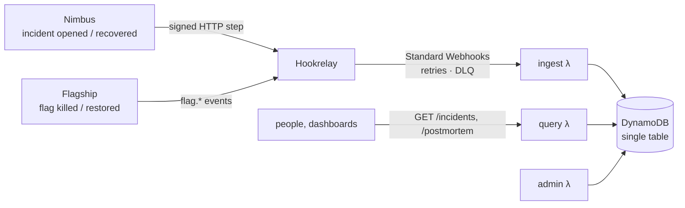

# Bitácora

**The incident ledger of [Atalaya](https://github.com/DRTX2/atalaya).** It subscribes to Hookrelay webhooks, rebuilds each incident's timeline from events published by different products, measures the response, and drafts the postmortem. *Bitácora* is Spanish for logbook.

Serverless on AWS: API Gateway (HTTP API) → three Lambda functions → DynamoDB, all in Terraform. Locally the same handlers run behind a small HTTP adapter, with DynamoDB Local.



## What it does

Atalaya closes the loop **detect → mitigate → notify → recover**. Bitácora adds the last step, **learn**:

- **Timeline:** `incident.opened` (Nimbus), `flag.killed` (Flagship automation), `incident.escalated` (automation could not mitigate), `incident.recovered`, `flag.restored`, and any change a person made to the flag during the incident.
- **Response metrics:** time to mitigate (opened → flag off), time to recover, and time to restore the flag after recovery.
- **Postmortem draft** in Markdown: facts from the timeline, observations ("a person changed the flag, so automation didn't restore it"), and follow-ups for the team. Example from a real run: [atalaya/docs/postmortem-example.md](https://github.com/DRTX2/atalaya/blob/main/docs/postmortem-example.md).

## API

| Route | Auth | Purpose |
|---|---|---|
| `POST /webhooks/hookrelay/{sourceId}` | Standard Webhooks signature | Ingest one delivery |
| `POST /sources` | Bearer token | Register a webhook source, get its URL |
| `PUT /sources/{id}/secret` | Bearer token | Store the signing secret Hookrelay issued for that URL |
| `GET /incidents?limit=20` | Bearer token | Incidents, newest first, with metrics |
| `GET /incidents/{id}` | Bearer token | Incident, metrics and timeline |
| `GET /incidents/{id}/postmortem` | Bearer token | Postmortem draft (`text/markdown`) |

Ingest status codes are chosen for Hookrelay's retry policy: `200` stops retries (including duplicates), `401` bad or stale signature, `404` unknown source, `409` source not connected yet (Hookrelay retries until the secret is stored).

## Design decisions

| Decision | Why |
|---|---|
| **A webhook consumer, not another integration** | Bitácora only talks to Hookrelay. Nimbus and Flagship don't know it exists, so adding it changed neither (beyond Nimbus now stamping `occurredAt`, which any consumer benefits from) |
| **Order-independent, idempotent writes** | Events come from two publishers with independent retries and DLQ replays, so any order is possible (a restore can even arrive before its kill). Writes key on the webhook id with `if_not_exists` timestamps, and flag changes are linked through a per-flag history, so arrival order and redeliveries don't change the result ([ADR-0002](docs/adr/0002-idempotency-and-ordering.md); the restore-before-kill case was found by an Atalaya game day) |
| **Mark a delivery as seen after processing, not before** | A crash in between means Hookrelay's retry reprocesses (harmless), never that an event is lost |
| **Source time, normalized** | Incidents use Nimbus' `occurredAt`, not delivery time (the notify step runs after the flag step). All timestamps are normalized to fixed-width ISO because they are DynamoDB sort keys, compared as text |
| **Serverless + single-table DynamoDB** | Spiky, low-volume traffic (incidents, not page views): pay per request, nothing to patch, scales to zero ([ADR-0001](docs/adr/0001-serverless-single-table.md)) |
| **Three functions, least privilege each** | `ingest` writes, `query` only reads, `admin` manages sources. A bug in the read path can't write |
| **Correlation by contract, not by guess** | A kill is linked to its incident by Flagship's audit text `killed by nimbus incident <id>` *and* the actor `nimbus (automation)`; a person typing that text is treated as a manual change |

## Run it

```bash
npm ci
docker compose up -d --wait     # DynamoDB Local + the handlers on :8090
npm test                        # 16 unit tests
npm run test:integration        # 8 tests against DynamoDB Local
```

Inside Atalaya it starts with everything else (`docker compose up` in the atalaya repo) and `bootstrap.mjs` subscribes it to Hookrelay.

## Deploy (AWS)

```bash
npm run build                                   # one bundle per function in dist/
cd infra/terraform
terraform init -backend-config=backend.hcl      # see backend.hcl.example
terraform apply -var api_token=...              # outputs api_url
```

What it creates: DynamoDB (on-demand, point-in-time recovery, TTL on dedupe markers, deletion protection), a customer-managed KMS key with rotation for the table and logs, three arm64 Lambda functions with X-Ray tracing and least-privilege roles, the HTTP API with throttling and JSON access logs, and CloudWatch alarms (function errors, bursts of rejected signatures). `terraform validate` and Trivy pass with no findings. It has **not been applied** to an AWS account yet.

## Limits (known, on purpose)

- The API token lives in the KMS-encrypted Lambda environment. Move it to Secrets Manager when it needs rotation.
- Incidents only appear in the list once `incident.opened` arrives (a flag event alone creates a partial record that isn't listed yet).
- The postmortem is deterministic. An LLM could write the narrative, but facts and timings should stay computed, not generated.
- One tenant. Multi-tenant would add the tenant to every partition key.
